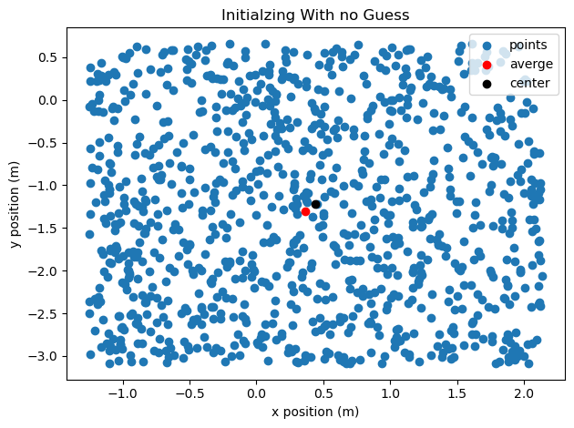
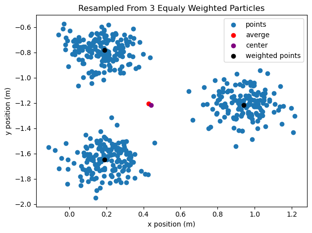
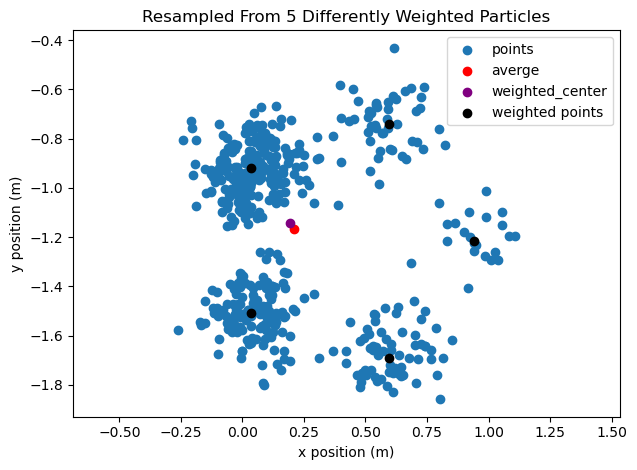
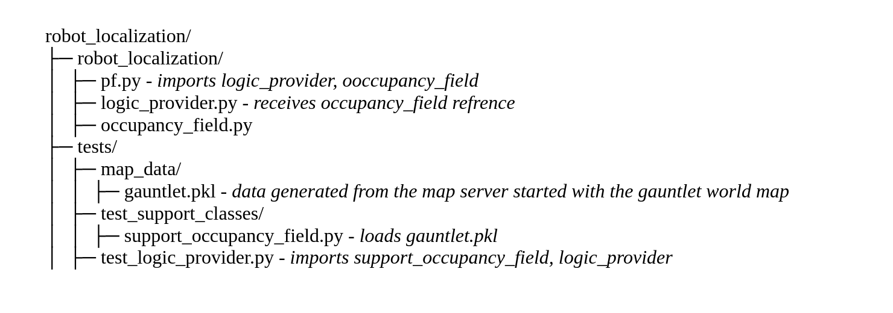
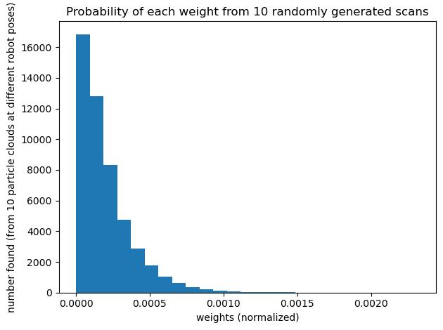
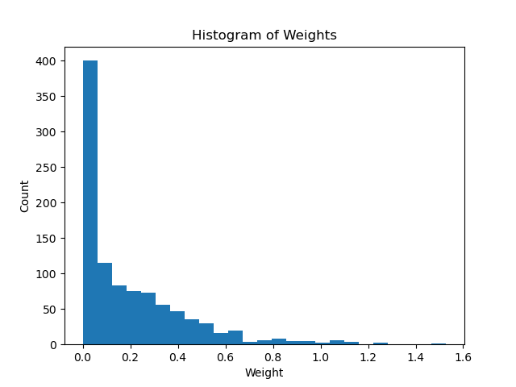
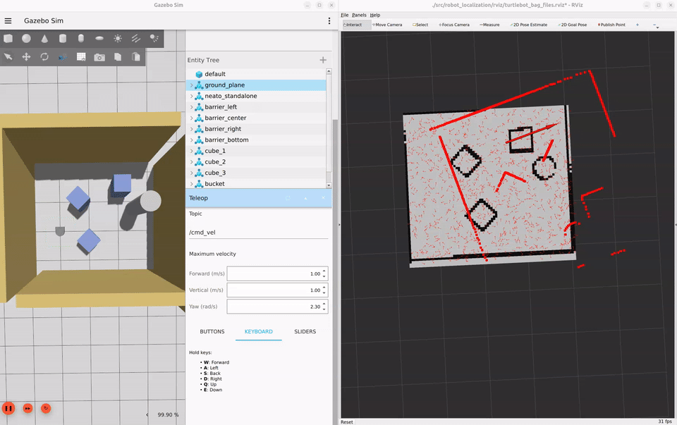
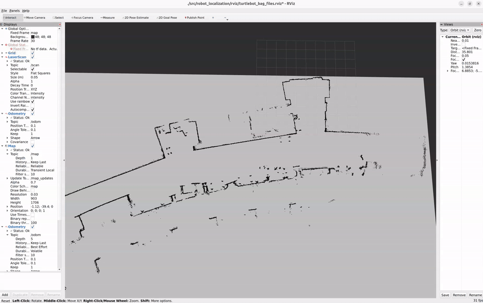
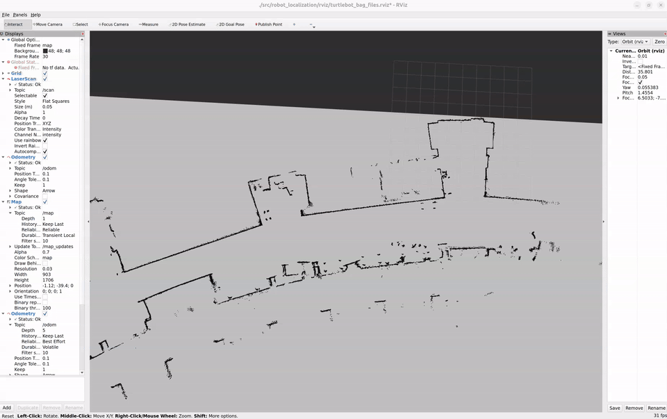

# **State Estimation and Localization Project**

Author Names: Austin Woolf, Harlan Haller

For Olin ENGR3590 Computational Introduction to Robotics

# **Project Overview**

### Project Goals

For the Robot Localization project in Computational Introduction to Robotics, we were tasked with writing a particle filter algorithm in python for ROS2 to estimate the 2D position and heading of a Neato (a brand of robot vacuum). We used a map of the area, scans from a 360° LiDAR (laser) sensor, and the odometry data from the robot, to estimate its pose. We wanted to make this particle filter work well even without an initial guess. We did this by starting with a uniform distribution of robot pose guesses and resampling them each iteration by how well they made the laser scan line up with the map.

### Key Takeaways

During this project we learned more about how to work in ROS2, design unit tests, and use python libraries. We used ROS tools that we didn't have much experience with, like rviz and rosbags. We implemented an architecture for unit testing in ROS, where we did most of our logic in testable methods outside of our node class. Similarly, we got more experience writing tests, which we hadn’t done much before. We also used python libraries that we didn’t have much experience with that were greatly helpful and will be very useful for us in the future, like numpy, pytest-plt/matplotlib, and scipy.

# **Approach to State Estimation**

## **Algorithm Overview**

### Initializing particles

Since we are following the captured Neato version of this assignment, when the program is started we initialize particles uniformly within the bounds of the map. We did also implement a version of this function that will distribute particles on a gaussian centered on the guess. We choose the theta value using a von Mises distribution because it is a closed form circular distribution.

|  |  |
| :---- | :---- |
| Figure \#: A plot of the position of points generated by our program initializing the particle cloud. This shows that the particles are uniformly distributed within the expected range. Generated by running pytest \--plots. | Figure \#: A plot of the positions of points generated by our program initializing the particle cloud with a guess. This shows that our particles generate properly about the provided guess. Generated by running pytest \--plots. |

### Motion update

We derived the equations we used to perform the particle update in matlab as a matrix transformation. We then implemented this transformation in code. We started with one transform that would transform the change in the odom reference frame to the base\_link frame. We then use a homogenous transform to both translate each particle by the robot's translation and rotation relative to each particle's “base\_link,” and then convert this position to the map frame using each particle's position and rotation. The matrices to do this are: INSERT LATEX HERE Combining and simplifying these transformations yields this final set of update equations, which we implemented in code: INSERT LATEX HERE

### Observation update

Each time we resample the particles we weight them by comparing the latest laser scan from the robot to the map of the area it’s in. We first project each data point from the scan, from polar coordinates to cartesian. Then, we use the pose of each particle to rotate and translate the scan from the robot frame to the map frame, as if the particle took the scan itself. Then, for each particle we compare each scan point to the map. We find the distance from each scan point to the nearest obstacle on the map using a pre-calculated distance field. Next, we plug each distance into a gaussian probability distribution function to weight them. This way, close distances are weighted highly and far distances are weighted low, but there’s no spike or discontinuity at zero, like there would be if we took the reciprocal of the absolute value. The weight of each particle is calculated by taking the mean of these weighted distances. The final step of the process is to normalize the weights of the particle cloud such that all the weights sum to one. We do so by dividing each weight by the sum of the weights of the particle cloud. This makes resampling simpler as each particle’s weight can be treated as the probability that any given new particle will be based off of its pose.

### Updating the robot pose

To estimate the pose of the robot each frame, we use the position and angle of the particle with the highest weight. This way, no matter what the particle cloud looks like, our estimated robot pose is always our best guess based on our latest data. We considered basing the pose off of a weighted average of the particles, but if there were multiple highly weighted groups of particles, we wouldn’t want the estimated pose to be between them. We also considered using a grouping algorithm to find the highest weighted cluster of particles. If we had time to implement and calibrate one, it might have made the estimated pose jump around less and be more representative of the particle cloud as a whole. We are satisfied with the performance of our method, despite its simplicity.

### Resampling particles

To resample the particles we select new particles using the provided `draw_random_sample` function, with all particles as possible outputs, and each particle's weight as its chance of occurrence. We then apply some noise to each chosen particle in the form of a small positional and angular displacement. The positional noise is selected from a gaussian distribution and the angular noise is selected from a von Moises distribution. The standard deviation for the gaussian and the parameter for the von Mises distribution were set in a config yaml file. This is one of the two main sources of purposeful noise in our system.

|  |  |
| :---- | :---- |
| Figure \#: Particles resampled from an initial particle cloud with 3 equally weighted particles. This shows that oour points correctly generated about weighted particles. Generated by running pytest \--plots. | Figure \#: Particles generated from an initial particle cloud with 5 particles with weights (starting from the right most particle and moving counter-clockwise) of 0.05, 0.1, 0.5, 0.25, and 0.1. This shows that our points are correctly resampled more around higher weighted points than lower weighted points. Generated by running pytest \--plots. |

## **Implementation Design**

### How We Chose to Weight Particles

Our original plan for weighting particles was to find the distance to, and angle relative to, the nearest obstacle, for both the real robot, and each particle. This would have discarded most of the data from the laser scan, boiling it down from 360 points to one. However, it also would have allowed us to isolate position and angle into values that we could weigh and resample for separately. For example, if any given particle was a good distance from the closest obstacle, but at a bad angle, we could have changed the standard deviation of the resampling noise, to keep the position, but search for a better angle. Although we liked the prospect of being able to weigh the particles separately, we were concerned that we were discarding too much information. One major design decision we made was to pivot to the method we use in the final version. We decided to do so when we discovered that the skeleton code we were provided couldn’t be easily modified to calculate the angle from any given point to the nearest obstacle on the map.

### Designing an Architecture for Testing \- H

Another major design decision we made was to restructure our repository to facilitate in depth testing. The main particle filter depends on threading and methods provided by ROS to a live node. This made it hard to test specific elements of the particle filter with the standard methods that are applied to most python programs. To work around this we split out all the methods we had to implement for the particle filter into a separate class we call the `logic_provider`. All the functions inside of the logic provider are kept as pure as possible, with the only internal state being a set of parameters loaded on startup that are not modified. This restructuring allows us to import this logic provider both into the particle filter and testing file to allow for easy testing of all methods with simulated data. 

For most of our functions it is easy to create test data to pass into them. For example most functions expect to take in a particle cloud composed of a list of particles. We were able to generate this by moving the Particle class to the logic provider file as well and importing it into the testing file, allowing us to create fabricated particle clouds to pass in for testing. The one structure that took additional work was that of the occupancy field class. This class relies on using a service provided by a third-party map server node. However, we noticed that this class only uses the map server during the initialization, and once data is acquired the methods provided by the class are just data retained as objects within the class. To emulate this behavior in testing we generated a pickle file from the map server data and imported this data into a testing version of the class that imported the data from a file instead of relaying on the map server. A simplified version of our project structure after these changes is shown in figure \#.

  
Figure \#: A simplified diagram of the project repository annotated to show where files are imported.

## **Unit Test Design and Integration**

For this project we developed a comprehensive testing suit of 17 unique tests split across every function we developed. We developed these tests early, and throughout the project as we changed our logic methods. Testing proved a great help in the development process, and we were able to catch several bugs by using them. All of our pytest tests are contained in the tests/test\_logic\_provider.py file. To run our tests ensure dependencies have been installed as described in the [how to run section](#how-to-run), then run when in the robot localization package folder run `pytest --plots`. The \--plots flag provides a matplotlib fixture to some of our tests to generate plots.

### Initializing particles \- 3 tests

1. test\_number   
   1. Tests that the number of particles generated is correct  
2. test\_avg\_uniform  
   1. Tests that when initializing without a guess the center of mass for all particles is the center of the map  
   2. This method generates a plot for visual confirmation  
3. test\_avg\_with\_guess  
   1. Tests that when initializing without a guess the center of mass for all particles is the guess  
   2. This method generates a plot for visual confirmation

### Motion update \- 4 tests

1. test\_move\_1p\_1  
   1. Tests moving a particle from a hand selected position to a position calculated in matlab  
2. test\_move\_1p\_2  
   1. Tests moving a particle from a different hand selected position to a position calculated in matlab  
3. test\_move\_5p  
   1. Tests moving 5 particles at once form hand selected starting points. Correct end points calculated in matlab  
4. test\_move\_many  
   1. Tests moving a large number of particles from points selected from a meshgrid over a range from  \-5 to 5 on both axes

### Observation update \- 4 tests

1. test\_positive  
   1. Tests that weights are always more than or equal to zero  
2. test\_float  
   1. Tests that weights are always of type float  
3. test\_not\_nan  
   1. Tests that weights are never not a number  
4. test\_boundary\_enforcement  
   1. Tests that particles on the map have a weight above zero  
   2. Tests that particles off the map (outside of its axis aligned bounding box) are weighted zero.

Figure \#: We generated this using pytest-plt by uniformly sampling particle poses, randomly selecting laser scan ranges (min=\[0, 1\], max=5), uniformly sampling laser scan distances from those ranges, and weighting the particles based off of those ranges and the gauntlet world map. It shows that most weights in a random set of non-resampled particles are low but a few particles line up well with the robot.

We went through multiple iterations of weighting algorithms and had to tweak constants like the standard deviation of the gaussian distribution in our final version. We wanted to visualize how we were weighting the particles so we could be sure our method of weighting made sense. So, we used pytest-plt to visualize the distribution of weights, Figure \# shows the weight distribution of our final version. When writing our weight updating method we used this plot as qualitative validation for it.

### Updating the robot pose \- 1 test

1. test\_highest\_weight:  
   1. Tests that update\_robot\_pose returns the correct type of information  
   2. Tests that update\_robot\_pose is able to find a best particle to base its robot pose estimation on  
   3. Tests that the pose update\_robot\_pose estimates is the same pose as the that of highest weighted particle, or one of them if there is a tie

### Resampling particles \- 4 tests

1. test\_number  
   1. This test confirms that after resampling the number of particles is still correct.  
2. test\_1\_weighted  
   1. This method confirms that when resampling with one particle of weight 1 and all other particles weighted 0 that the center of mass of generated particles is on that particle.  
   2. This method generates a plot for visual confirmation.  
3. test\_3\_weighted  
   1. This method tests that when resampling with 3 particles each weighted ⅓ placed in a equal-latteral triangle and all other particles weighted 0 the center of mass is on the center of the triangle  
   2. This method generates a plot for visual confirmation, See figure \#.  
4. test\_different\_weights  
   1. This method tests that when resampling with 5 particles placed in a pentagon around a point with different weights, that the center of the resampled particles is about the weighted average of the 5 points.  
   2. This method generates a plot for visual confirmation, See figure \#.

### Additional Debugging

We did write a test to verify our normalize weights function that ensures weights sum to 1 after normalizing. 

In addition to our unit tests we developed a few ways to do additional debugging. One of these methods was publishing the robot pose on its own topic to verify that the transform was correctly moving the odom vector to the position it thought the robot was in on the map. This helped us sort out if rviz lag was the problem or if we had an issue in our robot pose selection.  

An additional test we did was to create a node that would spin once on running that would listen for the published /particle\_cloud topic and generate a histogram of the weights of the particles. This allowed us to ensure that weights were distributed in a way that made sense while the full program was running. An example of one of the histograms generated is depicted in Figure \#. Note that we were unable to run this file through ros2 run despite looking into CMakeLists files and colcon. To run this file simply run it with python via `python3 ./robot_localization/debug_info.py`, from the robot\_localization package.  
  
Figure \#: Histogram of weights showing that in our filter most weights are concentrated at or just above 0\. This is intended as we want the weights of our particles to drop off very fast as they move away from 0\. The weights in this histogram are normalized then multiplied by 1000\. This is done so that when plotted it is possible to see the difference in how weighted each point is.

## **Experimental Design**

We tested our particle filters performance in two main ways: using the gazebo simulator in the neato gauntlet world, and the pre-recorded bag file recorded on the mac first floor. We primarily used the gazebo testing method for our initial development as we were able to know where the robot actually was within the map, which made it much easier to assess filter performance. We later moved to testing on the bag file as it was exactly repeatable, and a more complicated environment. The consistency allowed us to isolate differences in performance to changed parameters, and the complexity provided greater challenge and more interesting environment to work in. The parameters used to run the particle filter for both of these tests are shown in figure \#.

| Parameter | Value | Description |
| :---- | :---- | :---- |
| n\_particles | 5000 | The number of particles to use in the PF |
| percent\_particles\_uniform | 0.3 | The percent of particles to reserve for uniform distribution in resampling |
| resample\_noise\_sd | 0.1 | The standard deviation of a gaussian used to determine the offset from any chosen particle, adds noise during the resample step |
| resample\_theta\_spread | 100 | The kappa parameter to a von Mises distribution to determine the theta value of resampled particles (mean set to the theta of the chosen particle to resample based off of) |
| laser\_gaussian\_sd | 0.05 | The standard deviation of the gaussian used to set a weight for a given distance between a projected laser point and the nearest wall in the occupancy field. |
| particle\_init\_sd | 0.5 | The standard deviation of a gaussian used to sample the offset from an initial guess provided to the PF |
| particle\_init\_theta\_spread | 4 | The kappa parameter to a von Mises distribution to determine the initial theta value of particles (mean set to the theta of the provided guess) |

Figure \#: Table of parameters that control the PF, their final value, and their meaning.

### Gazebo Testing

 
Figure \#: GIF of particle filter running with gazebo simulation, run at 2x speed. This video shows our filter localizing the neato in the neato gauntlet world.

As shown in figure \#, our filter performs well on the neato gauntlet world. One thing we found is that because the walls often take up most of the lidar’s FOV, this means that most of a particle's weight comes from aligning to the walls. This means that the particle often has to get to a location where obstacles within the wall take up a larger portion of the lidar points for the particle filter to collapse to a single point. A bag file recording output from our PF for a run similar to the one depicted in the gif is available on the [Github repository](https://github.com/HarlanHaller/robot_localization/tree/main/bags/pf_in_gazebo).

### Bag file testing

Figure \#: GIF recording of particle filter running with bag file recording taken from the first flor of the MAC. 

As seen in figure \#, our filter also performs well on the larger, more complex map of the first floor of the MAC. Note that we are not providing the particle filter an initial guess of the position of the neato. In the recording in figure \#, we are still able to collapse quickly but as shown in figure \#, this is not always the case. Occasionally we converge on an incorrect guess, to account for this and avoid particle death we assign a percentage of our particles (30%) to be uniformly distributed over the map, giving us a chance at finding the correct position. The bag file used for this test is available at bags/macfirst\_floor\_take\_2 in the robot localization package and online on the [Github repo](https://github.com/comprobo26/robot_localization/tree/main/bags/macfirst_floor_take_1). A bag file recording output from our particle filter for a run similar to the one depicted in the gif is available on the [Github repository](https://github.com/HarlanHaller/robot_localization/tree/main/bags/pf_in_mac).

Figure \#: GIF recording of particle filter running with bag file recording taken from the first flor of the MAC. This is run with the same parameters as figure \# but, due to random change we converge on an incorrect guess.

# **Challenges and Next Steps**

In our initial implementation of the particle filter we found it difficult to tune our parameters for the particle filter. This was parietal because the parameters we used were scattered across the program which made it hard to tweak them. We overcame this by moving all of them from being hard coded values to be in one YAML config file  we import so we could change them easily. In the future we could use this to easily swap out different parameter configurations if we needed to.

We were able to get to the point in the project where we were happy with the algorithms we implemented but there is still room to perfect our parameters. Our current method for doing this is by editing a YAML file and relaunching the particle filter node. This works well and is a clean way to do it but it’s not very efficient. If we had more time we could have utilized ROS Parameters for faster editing and testing of our variables.

We tuned our parameters based on one bag file. When changing between the bag file and the simulated world, we found that different parameters work better. This makes sense. The bag we used is in a much larger and more open area than the simulated world we used. If we had more time we would try tuning our parameters to different environments and make a system that is either a good general solution or can adapt to the world to work well in different environments.

Our particle filter looks like it works as intended and our current tests all pass with the exception of some that are stochastic and fail occasionally. However, we don’t have very rigorous tests, especially for our simpler logic, and we do very little testing that isn’t on our purely logical methods. If we had more time we would implement more rigorous tests and we would do more testing on files outside of our logic provider.

For this project, everything we did was on either a simulated robot or a recording of a real one. If we had more time we would experiment with running it on a real robot to see if that causes any issues and to fix them if it does.

# **Learning Objectives and Final Takeaways** 

## **Harlan’s Takeaways**

I did not make substantial progress towards any of my learning objects for this project, it simply wasn’t suited in a way where I could meaningfully pursue them. The one learning goal I can say I made progress most closely related to is my “design competency in ROS” goal. While I had intended to learn more about the lower level side of implementing ROS, in this project I did learn about the high level side when it comes to testing. 

I have not done a project before where I have written unit tests. Learning how to implement them will certainly be helpful in my future projects. Additionally, learning how to structure ROS code on a high level to be testable does make me overall better at making ROS projects.

Another major takeaway from this development process was how helpful having a way to visualize results is. The provided code to make visualization was very helpful and I will want to make similar visualization tools for my future work. Additionally, I found that making plots showing the output from the functions we designed proved a very useful validation tool. 

## **Austin’s Takeaways**

One of my learning goals for the semester was to learn how to manage programming teams so that they can work efficiently, minimizing delays due to prerequisite parts of the project not being done. Although I did not manage the team, which is my end goal, I did get experience working on a team that did a good job at version control. This project taught me some ways I could lead my team when I am the project manager in the next project.

My other learning goal was to implement an algorithm that detects and keeps track of the state of the robot and the world around it, such as SLAM, then makes decisions off of that calculated information. This project gave me experience writing a program that reads a map, helping me learn how to achieve the second half of this goal.

* When working with unfamiliar tools, like ROS is for me, it can be helpful to work in-person with teammates even if you’re doing different work. This makes it much easier to ask project specific questions that your teammate might have already figured out the answer to, and it can save a significant amount of time.  
* When working on a team, it’s important to write docstrings for interfaces as you implement them because it will make it much easier for teammates interacting with those interfaces to figure out how to do so.  
* There are many python libraries that can be quite useful. I was mostly excited about the ones like numpy and pytest-plt that have functionalities of MATLAB, which I am already experienced in.

## **Collective Takeaways**

* Due to a variety of factors including being busy, sick, and traveling, we were not able to meet to start the project as early as we hoped. This led to having less time available to tune our particle filter. In the future we would both try to make a more concerted effort to at least meet to distribute work earlier into the project so we could do more work independently.  
* When working with a program that is obviously either working or not, it’s less important to use unit tests for debugging as they’re only really better than a human at catching the edge cases. However, when working with something like a particle filter, which will never work perfectly, it’s much less obvious where the issue is, so unit tests are quite useful, even if they take longer to write than print statements.

# **How To Run**  {#how-to-run}

1. Set up an appropriate ROS2 Jazzy workspace with the standard CompRobo instructions. Be sure to follow the instructions [here](https://comprobo26.github.io/assignments/robot_localization#installing-supporting-packages) to install dependencies for this project  
2. Clone this repository into \<your\_ros\_workspace\>/src/robot\_localization.  
3. Install the package `scipy` which is required for some statistical distributions. Additionally we use `pytest`, `pytest-plt`, and `pytest-repeat` for our testing. Run `pip install scipy pytest pytest-plt pytest-repeat --break-system-packages` to install these packages  
4. From the root of your workspace, run colcon build \--symlink-install and re-source all your ROS2 workspace setup files.  
5. This program can be run in two main ways: with an interactable gazebo window in the gauntlet world, and by running a prerecorded bag file fit to the MAC 1st floor map. We recommend you run the bag recording option (option b).  
   1. To run with a gazebo window run each of these commands in a separate terminal instance: `ros2 launch neato2_gazebo neato_gauntlet_world.py`,  `ros2 launch robot_localization test_pf.py map_yaml:=./src/robot_localization/maps/gauntlet.yaml` and `rviz2 -d ./src/robot_localization/rviz/turtlebot_bag_files.rviz`. Then we recommend adding the teleop module into gazebo. To do this click on the 3 dots in the top right corner and then search for teleop. Click the name when it appears to add it in. Then scroll down and switch the mode to ‘keyboard’, this will allow you to drive the robot with w, a, s, d.  
   2. To run the version with data recorded from the first floor of the MAC run the following 3 commands in separate terminals. These should be done in order as running the `bag play` command will start outputting on topics. `ros2 launch robot_localization test_pf.py map_yaml:=./src/robot_localization/maps/mac_1st_floor_final.yaml`,  `rviz2 -d ./src/robot_localization/rviz/turtlebot_bag_files.rviz`, and finally `ros2 bag play ./src/robot_localization/bags/macfirst_floor_take_1 --clock`  
6. To change parameters of the particle filter edit the config file config/config.yaml. As long as the project was built with \--symlink-install rebuilding is not necessary after changing the config file.
